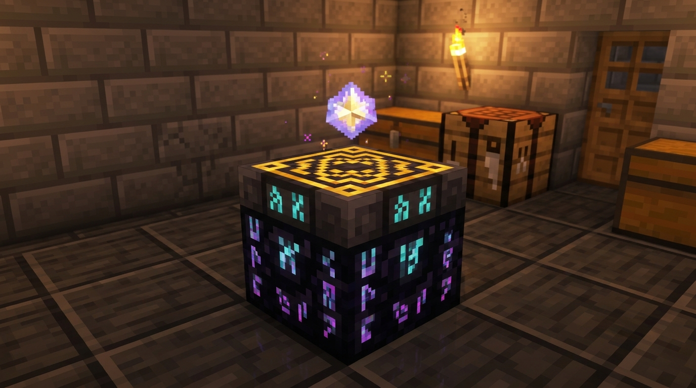
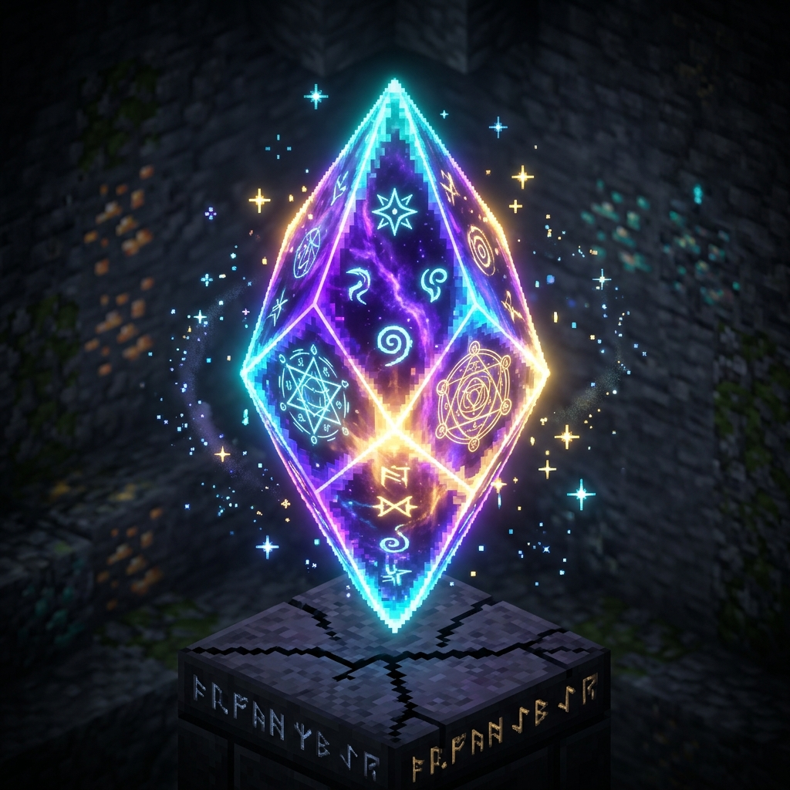
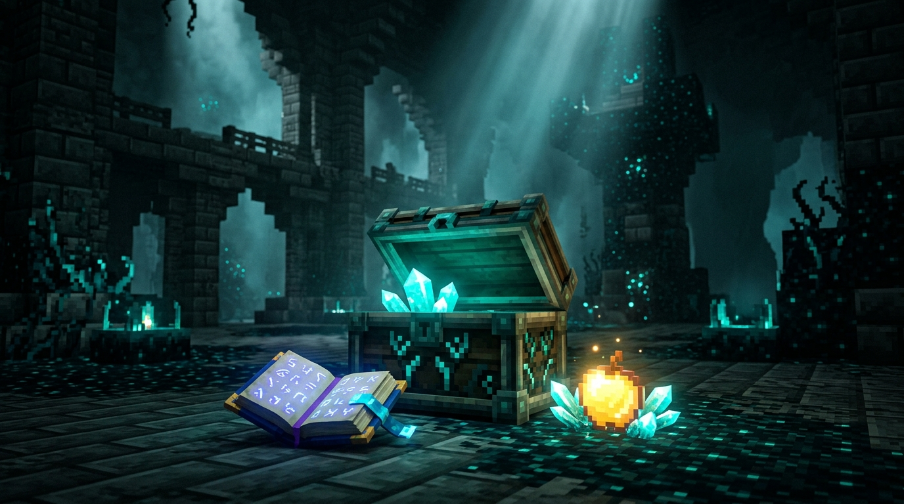

---
layout: default
title: "Accueil — ChouChou Mod Wiki"
---

# 📖 ChouChou Mod — Wiki Officiel

Portail de documentation officiel du **ChouChou Mod** (Minecraft 1.21.1 NeoForge).  
Ce wiki recense toutes les mécaniques ajoutées et équilibrées, leurs statistiques, leurs recettes et leurs sources de butin.

---

## 📑 Sommaire

1. [✨ Grimoire des Enchantements (89 Sorts)](enchantements.md) — Liste unifiée, paliers, incompatibilités et mécaniques.
2. [🔮 Système de Transcendance](transcendance.md) — Table de Transcendance, Cristaux d'Éther, recettes et dépassement de niveau (VI à X).
3. [🏆 Guide Officiel des Butins & Trésors](loot_tables.md) — Tables de butin 1.21, Chambres d'Épreuve, Cités Antiques, Bastions et pourcentages.
4. [🎒 Équilibrage des Sacs de Monstres](sacs_a_dos.md) — Répartition thématique des sacs à dos portés par les créatures.

---

## 🖼️ Aperçus Rapides

| Système | Aperçu |
| :--- | :--- |
| **Table de Transcendance** |  |
| **Cristal de Transcendance** |  |
| **Trésors des Cités Antiques** |  |
