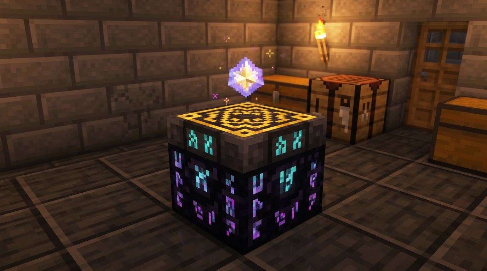
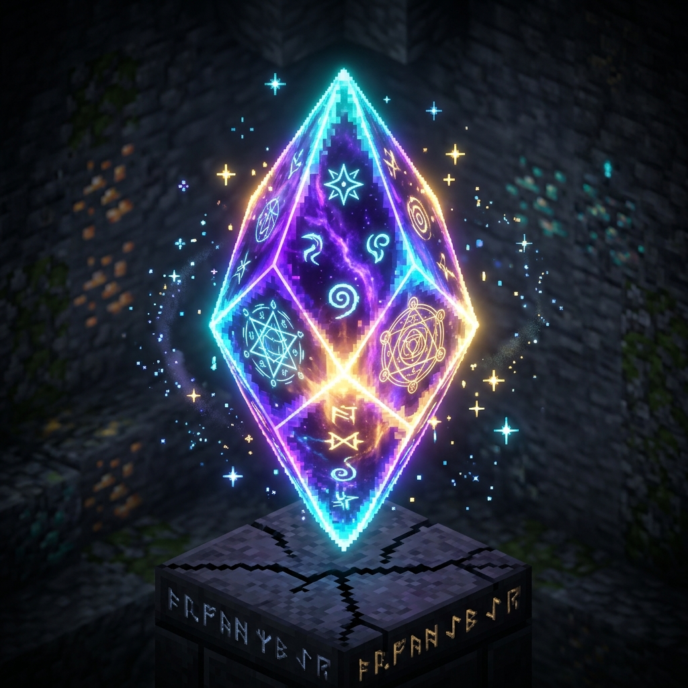
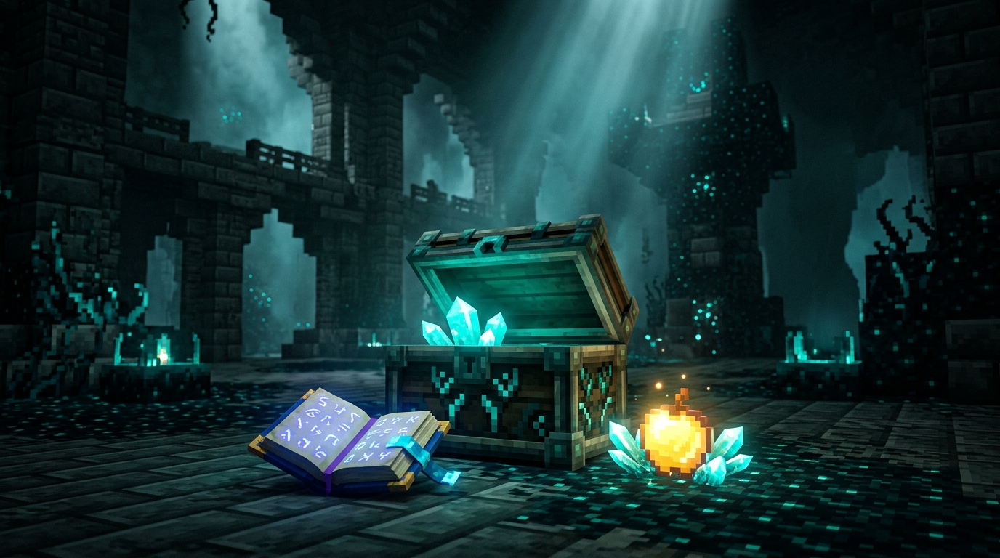

---
layout: default
title: "Accueil — ChouChou Mod Wiki"
---

# 📖 ChouChou Mod — Wiki Officiel

Portail de documentation officiel du **ChouChou Mod** (Minecraft 1.26.3 NeoForge).  
Ce wiki recense toutes les mécaniques ajoutées et équilibrées, leurs statistiques, leurs recettes et leurs sources de butin.

---

## 📑 Sommaire des Guides

1. [✨ Grimoire des Enchantements (82 Sorts)](enchantements.md) — Liste complète des enchantements actifs, formules d'effets, paliers et incompatibilités.
2. [🔮 Système de Transcendance](transcendance.md) — Table de Transcendance, Cristal de Transcendance, raffinage d'Éther et dépassement de niveau (VI à X).
3. [🎒 Sacs à Dos Évolutifs & Modules](sacs_a_dos.md) — Les 6 tiers de sacs, 17 modules d'amélioration, personnalisation par teinture et butin des monstres.
4. [🗿 Réseau de Waystones & Téléportation Coop](waystones.md) — Les 10 Waystones, 8 Sharestones, Pierre de téléportation et partage mondial immédiat.
5. [🛠️ L'Atelier, Recyclage & Gestion d'XP](atelier.md) — Table de décrafting, table de désenchantement, concasseur de géodes et bloc d'expérience global.
6. [🛡️ Slots Dédiés, Trade Cycler & Confort](slots_et_confort.md) — Port simultané Élytre/Plastron, slot de sac à dos, relance des villageois et sauvegarde automatique `/backup`.
7. [🏆 Guide Officiel des Butins & Trésors](loot_tables.md) — Tables de butin officielles, Chambres d'Épreuve, Cités Antiques, Bastions et pourcentages.

---

## 🖼️ Aperçus Rapides

| Système | Aperçu |
| :--- | :--- |
| **Table de Transcendance** |  |
| **Cristal de Transcendance** |  |
| **Trésors des Cités Antiques** |  |
