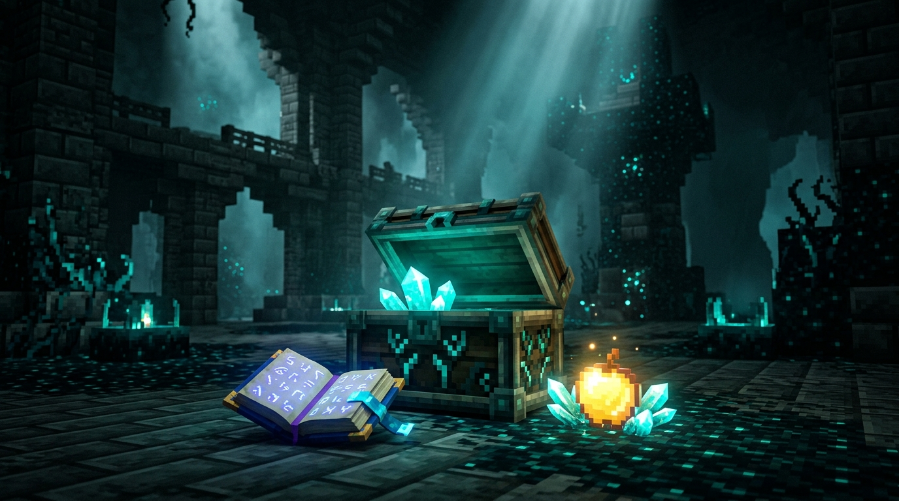

# 🏆 Guide Officiel des Tables de Butin & Trésors — Minecraft 1.21

Ce guide récapitule les **meilleurs trésors et tables de butin officielles** des structures majeures de Minecraft. Idéal pour savoir exactement **où chercher**, **quoi trouver**, et les **chances d'obtention** lors de vos explorations !

---

## 🏛️ 1. Chambres d'Épreuve (*Trial Chambers*) — Nouveauté 1.21

Les chambres souterraines en cuivre abritent les **Coffres-forts classiques (*Vaults*)** et les **Coffres-forts sinistres (*Ominous Vaults*)**, ouverts avec leurs clés respectives.

### 🗝️ Coffres-forts Sinistres (*Ominous Vaults*) — Butin Ultime
> Nécessite une **Clé d'épreuve sinistre** (obtenue via l'effet Mauvais Présage / *Bad Omen* dans la chambre).

| Trésor | Taux / Chance | Utilité & Rareté |
| :--- | :---: | :--- |
| **Noyau Lourd (*Heavy Core*)** | **7.5 %** | ⚡ **Composant clé de la Masse (*Mace*)**, introuvable ailleurs ! |
| **Livre : Explosion de vent (*Wind Burst*)** | **5.5 %** | 🌪️ Enchantement exclusif Masse (propulsion lors d'un coup réussi) |
| **Livre : Densité (*Density*)** | **11.4 %** | 💥 Dégâts accrus par bloc de chute |
| **Livre : Brèche (*Breach*)** | **11.4 %** | 🛡️ Réduit l'efficacité de l'armure ennemie |
| **Modèle de forge : Flux (*Flow Trim*)** | **22.5 %** | 🎨 Finition d'armure motif tornade / Breeze |
| **Bouteille sinistre (*Ominous Bottle*)** | **18.6 %** | 🧪 Permet de réactiver l'effet *Bad Omen* à volonté |
| **Pomme dorée enchantée (Notch)** | **3.1 %** | 🍎 Survie extrême et régénération |

---

## 🌌 2. Cités Antiques (*Ancient Cities* — Tréfonds / Deep Dark)

Situées sous la couche Y: -50, ces gigantesques ruines de Sculk renferment le butin le plus précieux de l'Overworld.

### 📦 Coffres de la Cité Antique

| Trésor | Taux par coffre | Description & Particularités |
| :--- | :---: | :--- |
| **Livre : Furtivité Rapide (*Swift Sneak I-III*)** | **23.2 %** | 🥷 Marche accroupie à vitesse normale (Jambières uniquement) |
| **Fragment d'écho (*Echo Shard*)** | **29.8 %** (1 à 3) | 🧭 Nécessaire pour la **Boussole de Réapparition** (*Recovery Compass*) & Transcendence |
| **Modèle de forge : Silence (*Silence Trim*)** | **1.2 %** | 👑 Le motif d'armure le plus rare de tout Minecraft |
| **Modèle de forge : Gardien (*Ward Trim*)** | **5.0 %** | 🛡️ Motif orné inspiré du Warden |
| **Fragment de disque 5** | **29.8 %** (1 à 3) | 🎵 9 fragments permettent de reconstituer le disque musical 5 |
| **Pomme de Notch enchantée** | **8.4 %** | 🍏 Régénération V, Résistance, Absorption IV |
| **Houe en diamant enchantée** | **16.1 %** | ⛏️ Avec Fortune ou Toucher de Soie de haut niveau |

---

## 🐷 3. Bastions du Nether (*Bastion Remnants*)

Les Bastions sont la seule source de la forge en Netherite. Ils se déclinent en 4 variantes (Salle au trésor, Écuries de Hoglins, Pont, Logements).

### 💎 Salle au Trésor & Coffres Généraux

| Trésor | Taux (Salle au trésor) | Taux (Autres coffres) | Utilité |
| :--- | :---: | :---: | :--- |
| **Modèle de forge : Amélioration Netherite** | **100 %** (Coffre central) | **10.0 %** | 🔨 **Obligatoire** pour transformer Diamant en Netherite ! |
| **Débris antiques (*Ancient Debris*)** | **13.5 %** (1 à 2) | **5.7 %** | 🪨 Minerai brut pour lingots de Netherite |
| **Lingot de Netherite** | **4.2 %** | — | ⭐ Trésor rarissime déjà raffiné |
| **Modèle de forge : Groin (*Snout Trim*)** | **8.3 %** | **8.3 %** | 🐗 Motif d'armure Piglin |
| **Disque musical : *Pigstep*** | **5.6 %** | — | 🎧 Morceau exclusif composé par Lena Raine |
| **Magnétite (*Lodestone*)** | **100 %** (Coffre central) | — | 🧭 Permet de lier une boussole à une coordonnée fixe |

---

## 🚀 4. Cités de l'End & Navires (*End Cities & End Ships*)

Après avoir vaincu l'Ender Dragon, les îles lointaines de l'End offrent l'équipement le plus puissant du jeu.

### ⛵ Navire de l'End (*End Ship*)
- **Élytres (*Elytra*)** : **100 %** (1 paire garantie dans le cadre au fond de chaque navire).
- **Tête de Dragon** : **100 %** (À la proue du navire).
- **Support d'alchimie** : 2x Potions de Soin instantané II.

### 📦 Coffres de Cité de l'End
Les équipements générés ici ont un budget d'enchantement de niveau **20 à 39**, bien supérieur aux tables habituelles !

| Trésor | Taux d'apparition | Détails |
| :--- | :---: | :--- |
| **Armures en diamant enchantées** | **13.3 %** par pièce | 🛡️ Plastrons, casques, jambières souvent avec Protection IV |
| **Outils & Armes en diamant** | **13.3 %** par pièce | ⚔️ Épées, pioches, pelles avec Efficacité / Tranchant IV-V |
| **Carapaces de Shulker (*Shulker Shell*)** | — | 🎒 Drop garanti (50% de base, jusqu'à 100% avec Butin III sur les Shulkers) |
| **Modèle de forge : Flèche (*Spire Trim*)** | **6.7 %** | 🗼 Finition d'armure d'inspiration Shulker/Purpur |
| **Lingots de fer / or / diamants** | **20.0 % à 30.0 %** | 💰 Ressources pures par stacks |

---

## 🏰 5. Forteresses du Nether (*Nether Fortresses*)

| Trésor | Taux par coffre | Utilité |
| :--- | :---: | :--- |
| **Modèle de forge : Côtes (*Rib Trim*)** | **6.7 %** | 💀 Motif d'armure squelette du Nether |
| **Selle (*Saddle*)** | **35.3 %** | 🐎 Pour monter chevaux, arpenteurs et cochons |
| **Armure pour cheval en diamant** | **11.8 %** | 🛡️ Protection maximale pour votre monture |
| **Verrues du Nether (*Nether Wart*)** | **19.0 %** (3 à 7) | 🌿 Indispensable pour lancer l'alchimie |
| **Lingot d'or / Diamant** | **19.0 % / 4.0 %** | 🪙 Métaux précieux |

---

## 🗺️ 6. Trésors Enfouis & Monuments Marins

### 🏴‍☠️ Coffre de Trésor Enfoui (*Buried Treasure*)
Trouvé grâce aux **Cartes au trésor** dans les épaves sous-marines.

| Objet | Taux d'apparition | Rôle |
| :--- | :---: | :--- |
| **Cœur de la Mer (*Heart of the Sea*)** | **100 %** (1 par coffre) | 🌊 Requis pour fabriquer le **Conduit** (respiration et vision sous-marine infinies) |
| **Lingots de fer / or** | **100 %** (10 à 30) | 🪙 Matériaux abondants |
| **Prismarine & Cristaux** | **60.0 %** | 💎 Blocs aquatiques précieux |
| **Bouteille d'eau / Potion de respiration** | **30.0 %** | 🫧 Confort sous-marin |

---

## 🕸️ 7. Donjons Classiques & Mines Abandonnées

### 🕷️ Donjons à Spawners (Zombies / Squelettes)
- **Pomme dorée enchantée** : ~3.1 %
- **Selle** : 28.3 %
- **Livre enchanté aléatoire** : 15.1 %
- **Disques de musique (13, Cat)** : ~21.5 %
- **Armure de cheval en or/fer** : ~15.0 %

### ⛏️ Wagons de Mines Abandonnées (*Mineshafts*)
- **Rails (propulseurs, détecteurs, normaux)** : Abondants (>50%)
- **Graines de pastèque & citrouille** : 27.3 %
- **Pioche en fer / lingots** : 35.0 %
- **Livre enchanté** : 14.1 %
