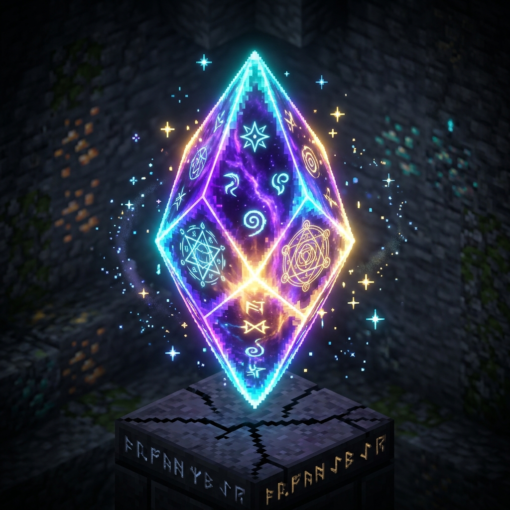
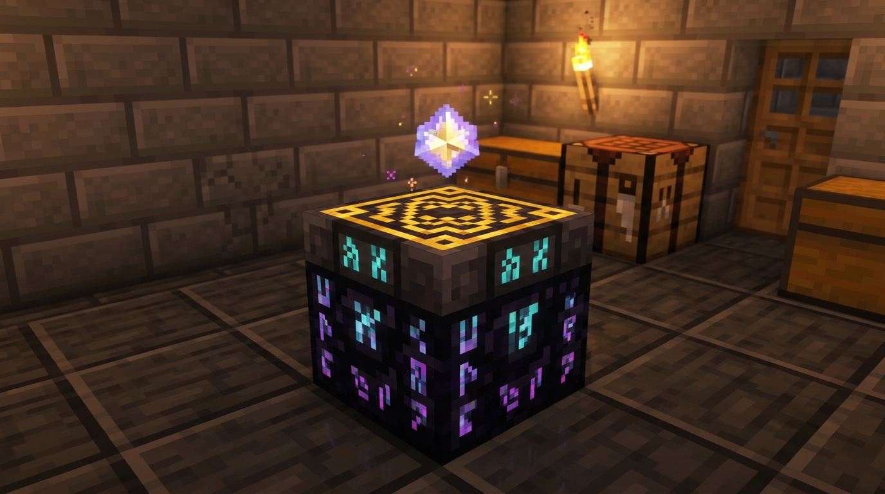
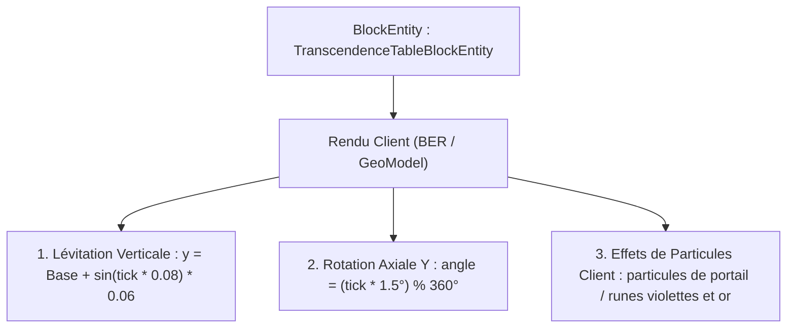

---
layout: default
title: "Système de Transcendance — ChouChou Mod"
---

# 🌌 Système de Transcendance — Guide Officiel (ChouChou Mod)

> **Module** : `enchanting_overhaul` (`EnchantingOverhaulFeature`)  
> Ce document formalise les recettes de fabrication, la chaîne de raffinage de l'Éther, les plafonds d'enclume et les spécifications de la **Table de Transcendance** (déblocage des enchantements de niveau 6 à 10).

---

## 💎 1. Cristal de Transcendance (`chouchou:transcendence_crystal`)

### 📖 Rôle & Mécanique
- **Usage exclusif** : Ce joyau sert de catalyseur ultime pour faire passer un enchantement du **Niveau 9 au Niveau 10** (palier d'apothéose).
- **Rareté** : Objet d'artisanat précieux de fin de jeu, nécessitant de l'or, des gemmes d'éther et une étoile du Nether.
- **Composant clé** : Indispensable pour assembler la **Table de Transcendance**.

### 🛠️ Recette dans la Table de Craft (3×3)

| | Colonne 1 | Colonne 2 | Colonne 3 |
| :---: | :---: | :---: | :---: |
| **Ligne 1** | 💠 **Gemme d'Éther** | 🪙 **Lingot d'Or** | 💠 **Gemme d'Éther** |
| **Ligne 2** | 🪙 **Lingot d'Or** | ⭐ **Étoile du Nether** | 🪙 **Lingot d'Or** |
| **Ligne 3** | 💠 **Gemme d'Éther** | 🪙 **Lingot d'Or** | 💠 **Gemme d'Éther** |

> **Résultat** : `1× chouchou:transcendence_crystal`

---

## 🏛️ 2. Table de Transcendance (`chouchou:transcendence_table`)

### 📖 Rôle & Fonctionnalités
- Station de travail mystique dédiée au dépassement des limites naturelles de l'enchantement.
- Permet d'infuser les équipements et livres pour débloquer les paliers **Niveau 6 à 10**.

### 🛠️ Recette dans la Table de Craft (3×3)

| | Colonne 1 | Colonne 2 | Colonne 3 |
| :---: | :---: | :---: | :---: |
| **Ligne 1** | 🔮 **Éclat d'Écho** *(Echo Shard)* | 💎 **Cristal de Transcendance** | 🔮 **Éclat d'Écho** *(Echo Shard)* |
| **Ligne 2** | 🛡️ **Lingot de Netherite** | 🌌 **Cristal de l'End** *(End Crystal)* | 🛡️ **Lingot de Netherite** |
| **Ligne 3** | 🟣 **Obsidienne Pleureuse** | 🟣 **Obsidienne Pleureuse** | 🟣 **Obsidienne Pleureuse** |

> **Résultat** : `1× chouchou:transcendence_table`

---

## ⛏️ 3. La Chaîne de Production de l'Éther (Endgame)

Pour alimenter la Table de Transcendance, le joueur doit exploiter les ressources de l'End :
1. **Minage du Minerai d'Éther (`chouchou:ender_ore`)** :
   - Se génère exclusivement dans la dimension de l'End entre Y = 10 et Y = 80.
   - Requiert au minimum une **Pioche en Diamant**.
   - Lâche 2 à 5 **Géodes d'Éther (`chouchou:raw_ender_ore`)** (augmenté par l'enchantement Fortune).
2. **Concassage mécanique (`chouchou:geode_cracker`)** :
   - Alimenté par de la **Poudre de Blaze** et équipé d'une **Pointe en diamant (`chouchou:diamond_tip`)** (1 pointe = 10 géodes concassées).
   - Chaque géode concassée a **5 % de chance (1 sur 20)** de révéler une **Gemme d'Éther (`chouchou:ender_gem`)**.
3. **Infusion de Transcendance** :
   - Les gemmes d'éther servent de catalyseur pour les paliers 6 à 9.
   - Huit gemmes d'éther associées à une Étoile du Nether forgent le **Cristal de Transcendance**.

---

## 🎬 4. Rendu 3D & Animation de la Table

Pour donner vie à la Table de Transcendance une fois posée dans le monde :

- **Hauteur de repos** : Le cristal flotte à environ 0.25 bloc au-dessus de la surface supérieure de l'autel.
- **Oscillation verticale (Bobbing)** : Mouvement sinusoïdal doux (`Δy = sin(clientTicks / 12.5) × 0.06`).
- **Rotation continue** : Rotation fluide sur l'axe Y (`θy = (clientTicks × 1.5°) mod 360°`).
- **Protection à la Meule** : Les équipements portant un enchantement transcende (Niveau > 5) sont **protégés contre le désenchantement destructeur à la Meule** Vanilla. Pour extraire un enchantement transcendé sans détruire l'objet, utilisez la Table de désenchantement.

---

## ⚖️ 5. Résumé de la Progression vers le Niveau 10

| Paliers d'Enchantement | Mode d'Obtention | Plafond Enclume | Catalyseur Requis |
| :--- | :--- | :---: | :--- |
| **Niveaux 1 à 5** | Tables d'enchantement standard, butins, villageois, enclumes | **Niveau 5** | Niveaux d'XP aplatis & Lapis-lazuli |
| **Niveaux 6 à 9** | Table de Transcendance uniquement | *Dépassé* | **1× Gemme d'Éther** + Niveaux d'XP par palier |
| **Niveau 10 (Ultime)** | Table de Transcendance exclusivement | *Dépassé* | **1× Cristal de Transcendance** + Niveaux d'XP ultimes |
