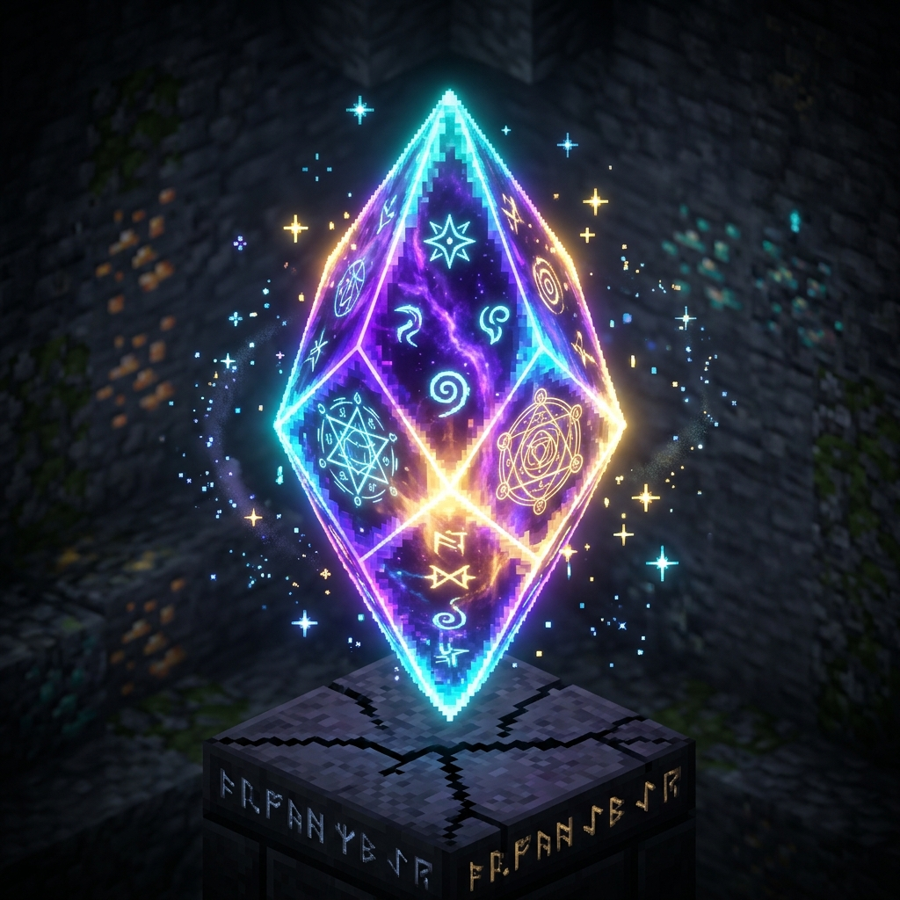
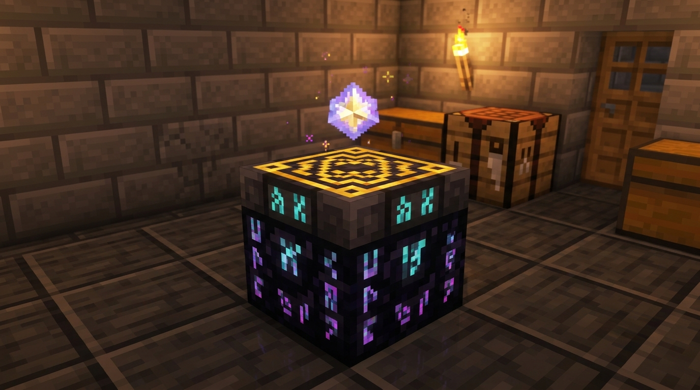
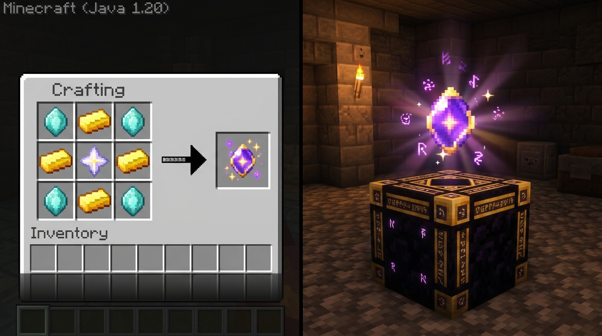
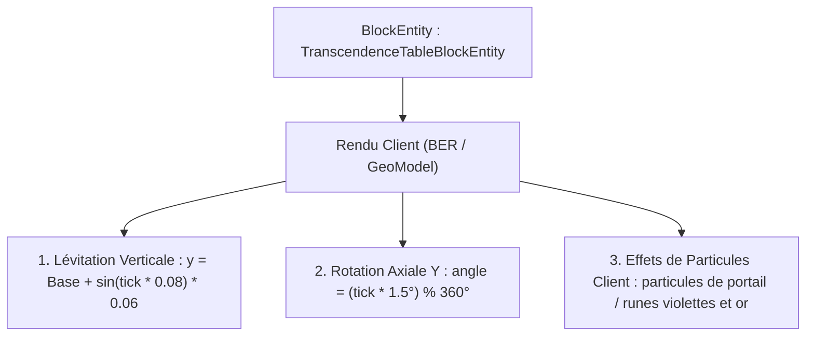

---
layout: default
title: "Système de Transcendance — ChouChou Mod"
---

# 🌌 Système de Transcendance — Spécifications & Recettes (ChouChou Mod)

> **Document de référence technique et design**  
> Ce document formalise les recettes de fabrication, les propriétés des items/blocs, et les spécifications d'animation pour le système de **Transcendance** (déblocage des enchantements de niveau 6 à 10).

---

## 💎 1. Cristal de Transcendance (`chouchou:transcendence_crystal`)

### 📖 Rôle & Mécanique
- **Usage exclusif** : Ce joyau sert de catalyseur ultime pour faire passer un enchantement du **Niveau 9 au Niveau 10** (palier d'apothéose).
- **Rareté** : Objet d'artisanat précieux de fin de jeu, nécessitant de l'or, des cristaux d'éther et une étoile du Nether.
- **Composant de base** : Indispensable pour assembler la **Table de Transcendance**.

### 🛠️ Recette dans la Table de Craft (3×3)

| | Colonne 1 | Colonne 2 | Colonne 3 |
| :---: | :---: | :---: | :---: |
| **Ligne 1** | 💠 **Cristal d'Éther** | 🪙 **Lingot d'Or** | 💠 **Cristal d'Éther** |
| **Ligne 2** | 🪙 **Lingot d'Or** | ⭐ **Étoile du Nether** | 🪙 **Lingot d'Or** |
| **Ligne 3** | 💠 **Cristal d'Éther** | 🪙 **Lingot d'Or** | 💠 **Cristal d'Éther** |

> **Résultat** : `1× chouchou:transcendence_crystal`

---

## 🏛️ 2. Table de Transcendance (`chouchou:transcendence_table`)

### 📖 Rôle & Fonctionnalités
- Station de travail mystique dédiée à la manipulation et au dépassement des limites naturelles de l'enchantement.
- Permet d'infuser les équipements pour débloquer les paliers **Niveau 6 à 10**.

### 🛠️ Recette dans la Table de Craft (3×3)

| | Colonne 1 | Colonne 2 | Colonne 3 |
| :---: | :---: | :---: | :---: |
| **Ligne 1** | 🔮 **Éclat d'Écho** *(Echo Shard)* | 💎 **Cristal de Transcendance** | 🔮 **Éclat d'Écho** *(Echo Shard)* |
| **Ligne 2** | 🛡️ **Lingot de Netherite** | 🌌 **Cristal de l'End** *(End Crystal)* | 🛡️ **Lingot de Netherite** |
| **Ligne 3** | 🟣 **Obsidienne Pleureuse** | 🟣 **Obsidienne Pleureuse** | 🟣 **Obsidienne Pleureuse** |

> **Résultat** : `1× chouchou:transcendence_table`

---

## 🖼️ 3. Showcase & Interface de Fabrication

---

## 🎬 4. Spécifications Techniques d'Animation du Bloc In-Game

Pour donner vie à la Table de Transcendance une fois posée dans le monde :

### 1. Physique du Joyau Flottant
- **Hauteur de repos** : Le cristal flotte à environ 0.25 bloc au-dessus de la surface supérieure de l'autel (hauteur totale environ 1.0 bloc).
- **Oscillation verticale (Bobbing)** : Mouvement sinusoïdal doux :
  `Δy = sin(clientTicks / 12.5) × 0.06`
- **Rotation continue** : Rotation fluide sur l'axe Y :
  `θy = (clientTicks × 1.5°) mod 360°`

### 2. Particules & Ambiance
- **Particules passives** : De temps à autre (tous les 10 à 20 ticks), de fines étincelles lumineuses violettes et dorées jaillissent du cristal.
- **Réaction à la proximité** : Lorsque le joueur s'approche à moins de 3 blocs, les glyphes runiques gravés sur le socle en obsidienne pleureuse augmentent légèrement d'intensité lumineuse.

---

## ⚖️ 5. Résumé de la Progression vers le Niveau 10

| Paliers d'Enchantement | Mode d'Obtention | Coût / Catalyseur Requis |
| :--- | :--- | :--- |
| **Niveaux 1 à 5** | Tables d'enchantement standard, butins de donjons, villageois, enclumes | Niveaux d'XP standard & Lapis-lazuli |
| **Niveaux 6 à 9** | Table de Transcendance | Niveaux d'XP supérieurs + minerais d'Éther |
| **Niveau 10 (Ultime)** | Table de Transcendance exclusivement | **1× Cristal de Transcendance** + Niveaux d'XP ultimes |
